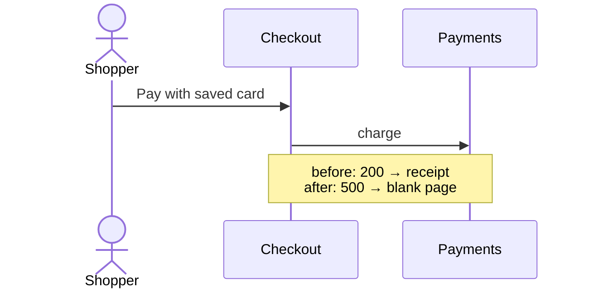

# Review folder

What step 7 writes. Overview first, zoom per group, details on demand: each file is one level, so the user opens only as deep as the decision needs.

## Location

Put it next to the settled sources when they live in a directory (`<tickets-dir>/review-<branch-or-topic>/`). Otherwise use `.scratch/review-<branch-or-topic>/`. Overwrite a previous folder only when its README names the same target; a folder for another target stays, and its `decisions.md` is read in step 1.

```
review/
├── README.md            verdict, gate counts, overview diagram, index
├── behavior.md          every observable change, by class, 🔴 first
├── over-engineering.md  mechanisms and their breaks-without-it evidence
├── decisions.md         blockers and open decisions; picks recorded here
├── findings.md          findings from any reviewer pointed here; recurrences become problems
├── groups/
│   ├── 01-<outcome>.md  one per group
│   └── …
└── ledger.md            every unit; opened only to audit completeness
```

Every 🔴, 🟠, and decision carries the same ID in every file (`B1` for a blocker, `D1` for a decision, `G1` for a group, `U1` for a unit) and links to its group file.

## README.md

```markdown
# Review: <target>
Reviewed: <base>..<tip sha> · <date>

**Goal:** <1–3 sentences> (<source>)

## Verdict
<✅ merge | ⛔ blocked by B1, B2 | ⚠️ merge after decisions D1–D3>
🔴 <n> regressions · 🟠 <n> unapproved · 🟢 <n> intended · ⚪ <n> invisible · over-engineering <n> flagged
<one line: ledger N/N units reconciled; mechanisms M/M reconciled; checks and mutations run; inferred: IDs or none>

## Overview
<mermaid flowchart, see below>

## Groups
| Group | Outcome | Behavior | Over-eng. | Provenance |
|---|---|---|---|---|
| [G1](groups/01-x.md) | <one sentence> | 🔴1 🟢2 | — | ticket 03 |

## For a reviewer pointed here
Your scope is the units in [ledger.md](ledger.md), judged against the goal above. Items in [decisions.md](decisions.md) are settled. Record each finding in [findings.md](findings.md), by its rules.
```

For a **plan** target, append **Gaps** (what shipping still needs: migration, rollback, who must be told, how success is measured) and a **Premortem** (the plan failed six months from now: the three likeliest causes).

## behavior.md

One section per change, 🔴 first, then 🟠, then 🟢. ⚪ is one count line at the end.

````markdown
## 🔴 B1 · <stakeholder> can no longer <capability>
**Who:** end user · **Group:** [G2](groups/02-x.md) · **Units:** U7, U9 · **Evidence:** verified, `<check>` passes on base and fails on tip

**Scenario:** <one concrete before → after story>



**Fix:** <what restores the capability>
**If asked why it blocks:** <one plain sentence>
````

A 🟢 entry is three lines: who, before → after, and the settled line it implements.

## over-engineering.md

| Mechanism | Group | Breaks without it | Tuning evidence | Why it was likely added | Decision |
|---|---|---|---|---|---|

## decisions.md

````markdown
## D1 · <question in plain words>   [open | picked A | picked B]
**Group:** [G3](groups/03-x.md) · **Class:** 🟠 unapproved
- **A, remove or simplify:** <what then happens, to whom>
- **B, keep or fix:** <what then happens, to whom; carry cost>
- **Recommend:** <A|B>, because <goal or settled line, or "simpler">. Principle: <name>
- **If asked why:** <one plain sentence>
````

Blockers appear first, with **Fix** in place of A/B. Keep the picks in the file across runs: they make up the settled list for the next run.

## findings.md

Written empty by scrutinize, filled by any reviewer pointed at the folder, kept across runs. The rules travel with the file, so a reviewer in a fresh context follows them without being told.

```markdown
# Findings

| ID | Unit | Origin | Kind | Status | Fix |
|---|---|---|---|---|---|

- **Origin** is the function where the wrong state first arises, not where it surfaces. The fix goes at the origin.
- **Kind** is a short reusable name for the class of defect ("stale wrapper used", "mechanism no test guards").
- Before adding a row, match it against every row by origin and by kind. A match with a `fixed` row is a **recurrence**: the earlier fix treated a symptom. Open a **problem** (`P1`, `P2`, …) under the table, listing every row it covers. Its fix starts with one test that goes red on all of them, made at their shared origin.
- A finding in a unit unchanged since the reviewed tip is a **review gap**: the earlier review missed it. Record it with kind `review gap: <kind>`.
- Statuses: `open`, `fixed <sha>`, `won't fix` (with the reason). A re-run checks only `open` rows, problems, and units changed since the reviewed tip.
```

## groups/NN-<outcome>.md

```markdown
# G1 · <outcome sentence>
**Provenance:** <settled lines> · **Author:** <if not the user's side>
**Units:** U1–U4, U9

<2–4 sentences: what this group does and how its parts fit>

<mermaid before/after diagram, only when the flow changed>

Behavior: <links to B/D entries, or "⚪ invisible">
Over-engineering: <links, or "none">
```

## ledger.md

| ID | Unit | Group | Provenance | Kind |
|---|---|---|---|---|

Close with the reconcile line: `<N> units = <source command> → <N>`.

## Mermaid

- **Overview**: one `flowchart LR` per stakeholder journey, running from where the stakeholder starts to the outcome they get. Fold every unchanged stretch into one node. Keep it under ~15 nodes. If it would be larger, draw one diagram per journey.
- **Color by class** with the same classes everywhere:

  ```mermaid
  flowchart LR
    A[Shopper opens cart] --> B[Checkout] --> C[Pay] --> D[Receipt]
    classDef regression fill:#fdd,stroke:#c00
    classDef unapproved fill:#ffe5cc,stroke:#e67e00
    classDef intended fill:#dfd,stroke:#2a2
    classDef same fill:#eee,stroke:#999,color:#666
    class A,B,D same
    class C regression
  ```

- **Before/after**: a `sequenceDiagram` per changed flow, with a `Note` stating the difference, or two small flowcharts labelled *Before* and *After*.
- Quote labels that contain `()`, `:`, `/`, or `"`, and keep each label short. Mermaid fails to parse the whole block on one bad label.

## Terminal summary

Mermaid doesn't render in a terminal, so print at most eight lines:

```
Verdict: ⛔ blocked by B1 · 🔴1 🟠2 🟢9 ⚪14 · over-eng 1
B1  end user can no longer open shared files (verified)
D1  new rate limit on exports: keep? (recommend A)
D2  retry wrapper with no failure evidence (recommend A)
Review: <path>/README.md
Scope: behavior and over-engineering; bugs and style are /code-review's
Reply with picks, e.g. "B1 fix, D1A, D2B"
```
